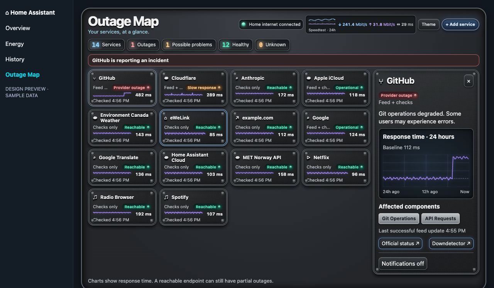
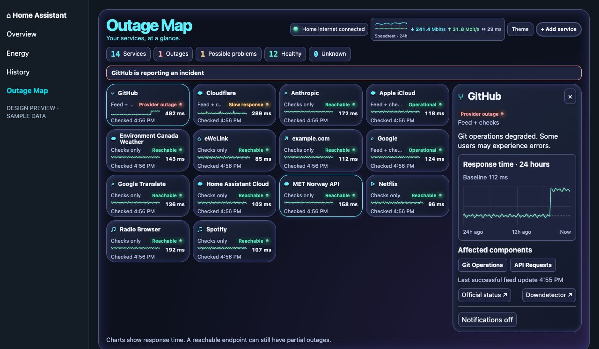
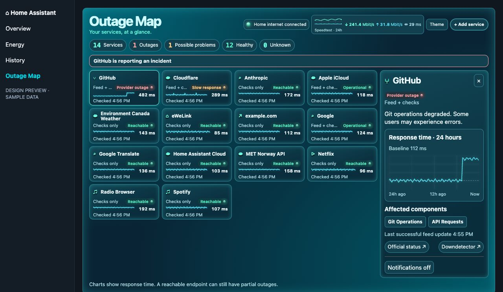
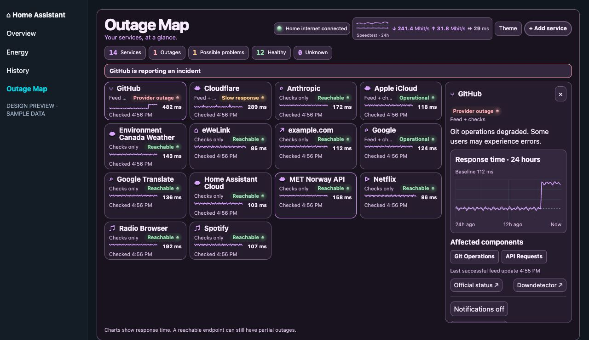

# Outage Map

A Home Assistant dashboard and sensors for provider incidents and checks from your own network.

Open [the sample dashboard](docs/card-preview.html) in a browser to try the layout and controls with fictional data.

## Already configured? Open or create a dashboard

If **Settings → Devices & services → Outage Map** shows an Outage Map entry, setup is complete. **Close the “Outage Map is already configured” dialog and skip the install steps.** One entity is normal before adding any monitors. It's the internet connectivity sensor.

1. Open **Settings → Dashboards → Add dashboard → New dashboard from scratch**. Name it **Outage Map** and select **Create**. You can also use an existing editable dashboard.
2. Open that dashboard and refresh the browser or reopen the Home Assistant app. Select **Edit dashboard → Add card**, then search for **Outage Map** and save it.
3. Click **+ Add service inside the Outage Map card** and choose a provider. The **Add service** button on the **Devices & services** page starts integration setup again.

**Seeing “Installed version” and “Up-to-date”?** That is the HACS/Marketplace update entity. Close it. If you added an entity tile to a dashboard, replace that tile with **Add card → Manual** using the configuration below. The dashboard card is a custom card and does not require selecting an entity.

The integration doesn't create a sidebar dashboard automatically. If the card is missing from the picker, choose **Manual** and paste this into the card editor:

```yaml
type: custom:outage-watch-card
```

If it says **Custom element doesn't exist: outage-watch-card** after refreshing, add `/outage_watch/outage-watch-card.js?v=0.2.0` as a **JavaScript module** in **Settings → Dashboards → Resources** (enable **Advanced mode** in your user profile if Resources isn't visible). Reload the dashboard. If the module URL returns 404, check that the integration is loaded and restart Home Assistant once after installation.

## Install for beta testing

[](https://my.home-assistant.io/redirect/hacs_repository/?owner=HoneyBearTech&repository=Home-Assistant&category=integration)

1. Click the button to open Outage Map in HACS. If the button cannot reach your instance, open **Custom repositories** in HACS and add `https://github.com/HoneyBearTech/Home-Assistant` as an **Integration**.
2. Download **Outage Map**, then restart Home Assistant.
3. In **Settings → Devices & services**, add **Outage Map** once if it isn't already listed. Then follow the dashboard steps above.

For manual installation, copy `custom_components/outage_watch` into your Home Assistant configuration directory under `custom_components/`, restart, and continue at step 3.

If you already use Outage Watch, the integration domain and card type are unchanged. Keep your existing config entry to retain settings, service IDs, and history. Back up your configuration before replacing the manually installed component with HACS files.

## Theme screenshots

All six screenshots use the same fictional service and Speedtest data. **Follow Appearance** is shown with an Amethyst palette and will look different with your active Home Assistant theme.

| Brushed Steel | Amber Relay |
| --- | --- |
| [](docs/screenshots/brushed-steel.jpg) | [](docs/screenshots/amber-relay.jpg) |

| Neon Grid | Midnight Drift |
| --- | --- |
| [](docs/screenshots/neon-grid.jpg) | [](docs/screenshots/midnight-drift.jpg) |

| Aqua Current | Follow Appearance |
| --- | --- |
| [](docs/screenshots/aqua-current.jpg) | [](docs/screenshots/follow-appearance.jpg) |

## What the dashboard reports

- **Feed + checks** combines a provider's public status feed and endpoint reachability. **Feed only** uses the provider's feed. **Checks only** tests a particular URL, so a successful request can miss an incident elsewhere in the service.
- With no tracked services, connectivity checks pause. With services tracked, Outage Map checks a primary connectivity endpoint and uses a fallback if the first is unavailable. Each installation schedules service checks at its own offsets. A provider can delay its next check using the Retry-After header. Repeated feed errors also increase the time between feed requests.
- Confirmed provider incidents and failures observed only from your Home Assistant are identified separately. When both connectivity checks repeatedly fail, service states become unknown and notifications pause.
- Latency charts and baselines use up to 24 hours of history stored locally. Gaps indicate missing or unsuccessful checks. Third parties receive normal HTTP requests from your Home Assistant. There is no telemetry.
- The initial catalog includes Statuspage feeds and public URL checks. A site may block automated checks from your network. The Apple iCloud catalog entry pairs an iCloud.com check with Apple System Status. An existing iCloud.com monitor is upgraded in place. It follows Apple's iCloud components and ignores resolved incidents and unrelated Apple services.
- The Google catalog entry combines a Google homepage check with the official Google Workspace incident feed. The feed covers Workspace products such as Gmail, Drive, and Calendar. Spotify and eWeLink monitor public web endpoints. Spotify also links to its official issue tracker.

For each service, use the status and problem entities in automations. URL checks also create a response-time sensor. Notifications are off by default.

## Appearance and Speedtest

Use **Theme** to pick a style or follow the current Appearance palette. The selection is stored in each browser. **Follow Appearance** uses the optional Yanke Appearance resource when available and native Home Assistant theme colors otherwise.

If the Speedtest.net integration exposes `sensor.speedtest_download`, `sensor.speedtest_upload`, and `sensor.speedtest_ping`, the header shows the available readings. Home Assistant History supplies the 24-hour chart. Administrators can run a test from the header. Custom entity IDs can be set with `speedtest_download_entity`, `speedtest_upload_entity`, and `speedtest_ping_entity` in the card config.

Please report reproducible beta issues on [GitHub](https://github.com/yanke7/Home-Assistant/issues). Include your Home Assistant version and the relevant error or steps to reproduce. Remove tokens, addresses, and personal data from logs or screenshots.
