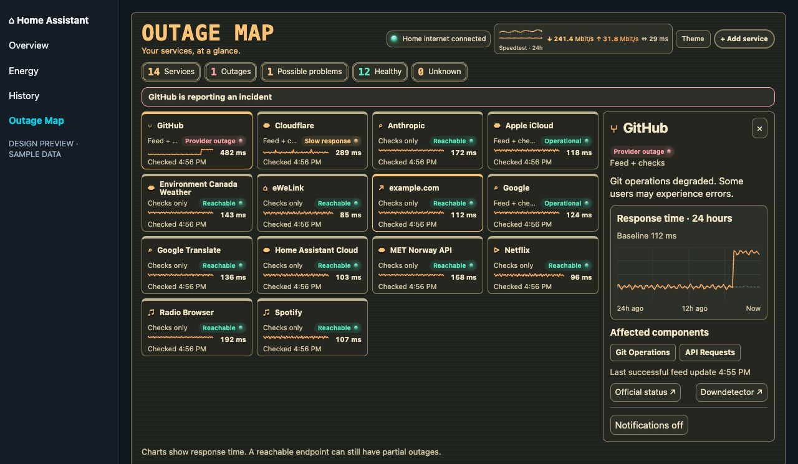
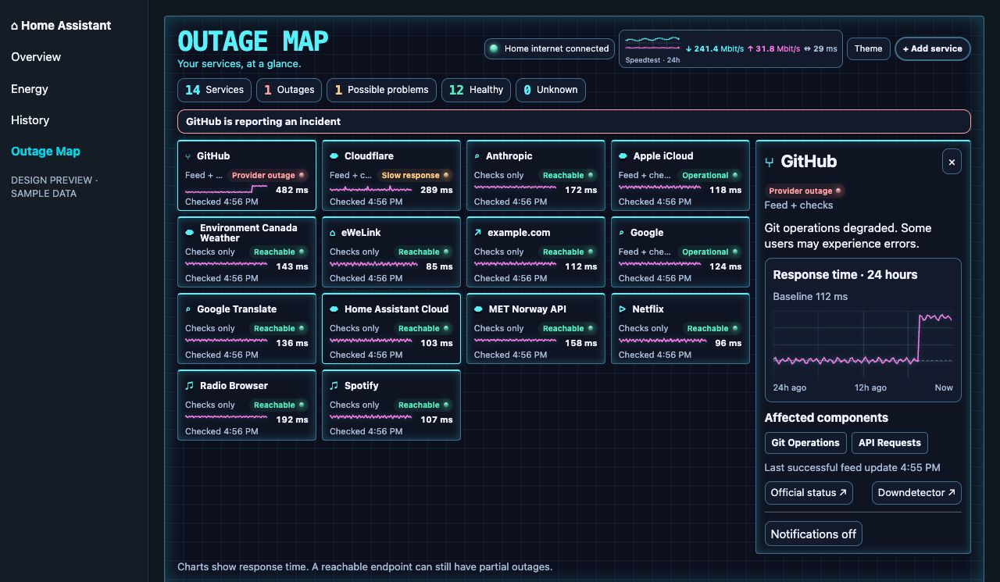

# Outage Map

A Home Assistant dashboard and sensors for provider incidents and checks from your own network.

Open [the sample dashboard](docs/card-preview.html) in a browser to try the layout and controls with fictional data.

## Install for beta testing

[](https://my.home-assistant.io/redirect/hacs_repository/?owner=yanke7&repository=Home-Assistant&category=integration)

1. Click the button to open Outage Map in HACS on your Home Assistant instance. If the button cannot reach your instance, open **Custom repositories** in HACS and add `https://github.com/yanke7/Home-Assistant` as an **Integration**.
2. Download **Outage Map**, then restart Home Assistant.
3. Open **Settings → Devices & services → Add integration → Outage Map**.
4. Create a dashboard, open it in edit mode, and add the **Outage Map** card. A panel view gives its service grid the full width. Refresh the browser after setting up the integration so it can load the bundled card.
5. Choose **Add service** to select providers from the catalog or enter a public HTTP(S) endpoint.

If the card picker is unavailable, use this card configuration:

```yaml
type: custom:outage-watch-card
```

For manual installation, copy `custom_components/outage_watch` from the repository into your Home Assistant configuration directory under `custom_components/`, restart, and continue at step 3.

If you already use Outage Watch, the integration domain and card type are unchanged. Keep your existing config entry to retain settings, service IDs, and history. Back up your configuration before replacing the manually installed component with HACS files.

## Theme screenshots

All six screenshots use the same fictional service and Speedtest data. **Follow Appearance** is shown with an Amethyst palette and will look different with your active Home Assistant theme.

| Brushed Steel | Amber Relay |
| --- | --- |
| [](docs/screenshots/brushed-steel.jpg) | [](docs/screenshots/amber-relay.jpg) |

| Neon Grid | Midnight Drift |
| --- | --- |
| [](docs/screenshots/neon-grid.jpg) | [](docs/screenshots/midnight-drift.jpg) |

| Aqua Current | Follow Appearance |
| --- | --- |
| [](docs/screenshots/aqua-current.jpg) | [](docs/screenshots/follow-appearance.jpg) |

## What the dashboard reports

- **Feed + checks** combines a provider's public status feed and endpoint reachability. **Feed only** uses the provider's feed. **Checks only** tests a particular URL, so a successful request can miss an incident elsewhere in the service.
- Confirmed provider incidents and failures observed only from your Home Assistant are identified separately. When both connectivity checks repeatedly fail, service states become unknown and notifications pause.
- Latency charts and baselines use up to 24 hours of history stored locally. Gaps indicate missing or unsuccessful checks. Third parties receive normal HTTP requests from your Home Assistant. There is no telemetry.
- The initial catalog includes Statuspage feeds and public URL checks. A site may block automated checks from your network. The Apple iCloud catalog entry pairs an iCloud.com check with Apple System Status. An existing iCloud.com monitor is upgraded in place. It follows Apple's iCloud components and ignores resolved incidents and unrelated Apple services.
- The Google catalog entry combines a Google homepage check with the official Google Workspace incident feed. The feed covers Workspace products such as Gmail, Drive, and Calendar. Spotify and eWeLink monitor public web endpoints. Spotify also links to its official issue tracker.

For each service, use the status and problem entities in automations. URL checks also create a response-time sensor. Notifications are off by default.

## Appearance and Speedtest

Use **Theme** to pick a style or follow the current Appearance palette. The selection is stored in each browser. **Follow Appearance** uses the optional Yanke Appearance resource when available and native Home Assistant theme colors otherwise.

If the Speedtest.net integration exposes `sensor.speedtest_download`, `sensor.speedtest_upload`, and `sensor.speedtest_ping`, the header shows the available readings. Home Assistant History supplies the 24-hour chart. Administrators can run a test from the header. Custom entity IDs can be set with `speedtest_download_entity`, `speedtest_upload_entity`, and `speedtest_ping_entity` in the card config.

Please report reproducible beta issues on [GitHub](https://github.com/yanke7/Home-Assistant/issues). Include your Home Assistant version and the relevant error or steps to reproduce. Remove tokens, addresses, and personal data from logs or screenshots.
